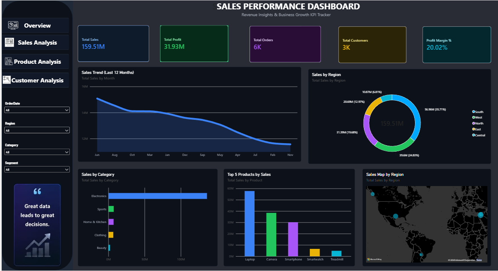

# Power BI Sales Dashboard

## Project Overview
This project presents an interactive Sales Dashboard developed using Microsoft Power BI to analyze sales performance and business trends.

## Tools Used
- Microsoft Power BI
- Microsoft Excel
- Power Query

## Dashboard Screenshot

## Key Features
- Sales performance visualization
- Interactive charts and graphs
- Business data analysis
- Dashboard reporting for better decision-making

## Project File
The Power BI report file is available in this repository:
- `Sales Dashboard.pbix`

## Objective
To present sales data in a clear, visual format and help users understand business performance and identify trends.

## Author
**Mohamed Ithrees J**

GitHub: [Mohamed-Ithrees](https://github.com/Mohamed-Ithrees)
